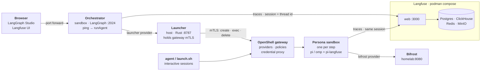

# software-factory

This repository contains coding agents ([pi](https://www.npmjs.com/package/@earendil-works/pi-coding-agent) and
[omp](https://github.com/can1357/oh-my-pi)) and a system that controls them. The agents run **only in
[NVIDIA OpenShell](https://github.com/NVIDIA/OpenShell) sandboxes**. They do not run on the host.

Each agent gets only the files, network access, and credentials that its persona permits. An agent cannot read
the rest of your disk, your credentials, or the internet.

## What do you want to do?

| You want to… | Go to |
|---|---|
| Run an agent on a repository, from any directory | [Run an agent](#run-an-agent) |
| Run a task through the factory loop and look at the traces | [Run the factory](#run-the-factory) |
| Add a persona, a skill, a provider, or change the model | [Change the fleet](#change-the-fleet) |
| Know why an agent fails or waits | [Known problems](#known-problems) |
| Know how the parts work together | [How it works](#how-it-works) |

## Before you start (one time)

You need these items for all workflows:

- **Podman** with a machine that runs. To start it, run `podman machine start`.
- **OpenShell CLI** (tested with 0.1.1). To check it, run `openshell --version`.
- **node or python3** on the host. `launch.sh` and `build.sh` use them to read `persona.json`.
- Bind mounts must be enabled in the gateway configuration at `~/.config/openshell/gateway.toml`:

  ```toml
  [openshell.drivers.podman]
  allow_driver_config = true
  enable_bind_mounts = true
  ```

- The Podman VM must have a connection to Bifrost at `homelab:8080`. Bifrost serves the model. Refer to
  [Model and inference endpoint](#model-and-inference-endpoint).

## Run an agent

Use this workflow to give an agent a task in a repository on your computer. The agent works on the directory that
you start it from.

### 1. Register the providers

Providers give the sandbox network access and credentials. Register them one time:

```bash
cd ~/Projects/software-factory/openshell
make providers                                          # push every providers/provider-*.yaml profile
openshell provider create --name bifrost --type bifrost # one provider per profile you use
openshell provider create --name context7 --type context7 --credential CONTEXT7_API_KEY   # reads it from your env
openshell provider list                                 # check
```

Some providers have no credentials: `bifrost`, `npm`, `googlefonts`, `vllm`, and `ninfer`. For these providers,
give only `--name` and `--type`. For `langfuse`, refer to [Look at the traces](#look-at-the-traces).

### 2. Build the images

```bash
./build.sh                 # harness images (cached) + all personas
./build.sh pi-web-dev      # one persona; edits to instructions/skills rebuild in seconds
./build.sh --dry-run       # print the podman commands only
```

The first build is slow. After that, a persona builds again in seconds.

### 3. Add the `agent` command to your shell

With this function, you can start an agent from all directories. Add it to `~/.zshrc`. It also operates in
`~/.bashrc`.

```sh
# software-factory: launch a sandboxed agent persona on the current directory
export SOFTWARE_FACTORY="$HOME/Projects/software-factory"

agent() {
  local launch="$SOFTWARE_FACTORY/openshell/launch.sh"
  if [ $# -eq 0 ]; then "$launch" --list; return; fi
  "$launch" "$@"
}

agent-build() { "$SOFTWARE_FACTORY/openshell/build.sh" "$@"; }

# zsh: tab-complete persona names
if [ -n "$ZSH_VERSION" ] && (( $+functions[compdef] )); then
  _agent() { compadd -- $(command ls "$SOFTWARE_FACTORY/openshell/personas"); }
  compdef _agent agent agent-build
fi
```

To load the function, run `source ~/.zshrc`.

### 4. Select a persona

A persona is one type of agent. It sets the harness (the agent CLI), the role, the skills, the filesystem policy,
and the providers.

| Persona | Harness | Policy | Mount | Use it to |
|---|---|---|---|---|
| `pi-general-dev` | pi | dev | read-write | Do general development. It has no skills for a specified stack. Also use it to test models and the harness. |
| `pi-web-dev` | pi | dev | read-write | Work on React, Next.js, and Vite. Headless Chromium (`agent-browser`) serves the app and examines it. |
| `omp-web-dev` | omp | dev | read-write | Do the same work as `pi-web-dev`, on the omp harness. |
| `pi-pr-reviewer` | pi | review | read-only | Review the mounted repository. It does not change code. |
| `pi-planner` | pi | review | read-only | Examine the codebase and write an architecture plan to `/tmp`. |

### 5. Start the agent

Go to the repository. Then start a persona:

```bash
agent                                   # list personas
cd ~/repos/my-next-app
agent pi-web-dev --dry-run              # print the exact openshell command; read it first
agent pi-web-dev                        # start pi on this repo, read-write
agent pi-pr-reviewer                    # same repo, read-only reviewer
agent pi-planner --mount ~/repos/other  # mount a different directory
agent pi-general-dev --no-mount         # no host files at all
agent pi-general-dev -- -p --no-session --mode json "summarise this repo" </dev/null   # headless
```

Your current directory becomes `/sandbox/work` in the sandbox, and the agent starts there. When the agent stops,
the sandbox is deleted.

### `launch.sh` options

| Flag | Effect |
|---|---|
| `--dry-run` | Shows the full `openshell sandbox create …` command. Runs nothing. |
| `--mount <path>` | Mounts this host path at `/sandbox/work`, not `$PWD`. |
| `--no-mount` | Mounts nothing. Use it with `--policy policies/strict.yaml`. |
| `--ro` | Makes the mount read-only. |
| `--policy <file>` | Replaces the policy of the persona. |
| `--provider <id>` / `--no-provider` | Adds a provider to the list of the persona, or removes all providers. |
| `--name <name>` | Sets the sandbox name. The default is the persona name. |
| `--keep` | Keeps the sandbox after the agent stops. |
| `--env K=V` | Gives an environment variable to the sandbox. You can use it more than one time. |
| `-- <args>` | Gives more arguments to the agent CLI. |

You can also use `make`: `make list`, `make run-pi-web-dev MOUNT=~/repos/app`, `make dry-pi-planner`.

## Run the factory

The factory is the outer loop. A LangGraph graph sends each step to a new headless persona sandbox. The graph runs
in its own sandbox. A small launcher on the host starts the persona sandboxes. This is the first version: the graph
runs one agent on one task.

[`factory/README.md`](factory/README.md) gives all of the details. The short procedure is:

```bash
# 1. Once: token + provider (the token lives in the gateway, never in the orchestrator sandbox)
mkdir -p ~/.config/factory && (umask 077; openssl rand -hex 32 > ~/.config/factory/launcher.token)
make -C openshell/providers update-launcher
FACTORY_LAUNCHER_TOKEN=$(cat ~/.config/factory/launcher.token) \
  openshell provider create --name launcher --type launcher --credential FACTORY_LAUNCHER_TOKEN

# 2. Once, and after changing package.json: build the orchestrator image (npm runs here)
make -C factory/orchestrator image

# 3. Terminal A: the launcher
cd factory/launcher && cargo run

# 4. Terminal B: the orchestrator; then open the Studio URL it prints
make -C factory/orchestrator dev
```

Open the Studio URL to see the graph and to start runs. Studio asks for a free LangSmith login. You can also start
a run over HTTP:

```bash
curl -s localhost:2024/runs/wait -H 'content-type: application/json' \
  -d '{"assistant_id":"factory","input":{"task":"What is 17 * 23? Reply with only the number."}}'
```

### Look at the traces

A self-hosted Langfuse records the traces of the orchestrator and of each agent. To start it, run:

```bash
make -C factory/langfuse up          # http://localhost:3000
```

The first time, make an account, a project, and API keys at http://localhost:3000. Keep the keys in your password
manager. Then give the keys to the `langfuse` provider.
[`factory/README.md`](factory/README.md#langfuse-tracing) shows the command.

In Langfuse, open **Sessions**. Each session is one LangGraph thread. It shows the `factory` traces and the
`pi-agent` traces that they started.

## Change the fleet

### Add a persona

1. **Role:** Use a file in `shared/instructions/roles/`, or write one new file for a new job.
2. **Payload:** Run `mkdir -p personas/<name>/payload`. Copy a payload from a different persona on the same
   harness.
3. **Manifest:** Write `persona.json`. Set the harness, image tag, policy, providers, `launch_cmd`,
   `mount_default`, and `mount_read_only`.
4. **Containerfile:** Copy the Containerfile from a different persona on the same harness. Change the role file and
   the payload path.
5. **Build:** Run `./build.sh <name>`.
6. **Check:** Run `./launch.sh <name> --dry-run`. Read the command that it shows before you run it.

[docs/personas.md](openshell/docs/personas.md) gives the full procedure.

### Add a skill

Put a directory with a `SKILL.md` file into `openshell/shared/skills/`. Then build the personas again. pi and omp
both read the same skills.

### Add network access

Egress is denied by default. If a role needs a new capability, add a provider profile first. Examples are the
GitHub API or a different package registry. Refer to [docs/providers.md](openshell/docs/providers.md).

### Change the model

Edit the persona payloads. For pi, edit `models.json` and `settings.json` (`defaultModel`). For omp, edit
`models.yml` and `config.yml`. Then build that persona again. Refer to [docs/models.md](openshell/docs/models.md).

### More guides

The guides in [`openshell/docs/`](openshell/docs/README.md) give more information:

- [Providers](openshell/docs/providers.md), with the difference between profiles and providers.
- [Personas](openshell/docs/personas.md).
- [Roles and skills](openshell/docs/roles-and-skills.md).
- [Policies](openshell/docs/policies.md).
- [Harnesses](openshell/docs/harnesses.md).
- [Models](openshell/docs/models.md).
- [Running and debugging](openshell/docs/running-and-debugging.md).

## Known problems

- **Headless pi needs a closed stdin** (`</dev/null`). If stdin is open, pi waits for it and does not stop.
- pi `--mode json` can stop with exit code 0 after a model error and a retry. Thus, do not use the exit code to
  find the result. Use `agent_settled` and the last `stopReason`.
- In the sandbox, use `http://localhost:PORT`. Do not use `127.0.0.1`. The sandbox drops IPv4 loopback traffic.
- When `pi-web-dev` runs `npm install` in the sandbox, `node_modules` gets Linux binaries. After this, run
  `npm install` on the host again.
- The reviewer needs a GitHub provider to get PRs directly. That provider is only a draft now.
- [`openshell/DESIGN.md`](openshell/DESIGN.md) shows the tests that passed end to end. It also shows the known
  problems of each harness. [`factory/README.md`](factory/README.md) shows the known problems of the factory.

## How it works

### Architecture



- **Only one host process has trust.** Only the launcher connects to the gateway. The orchestrator can tell the
  launcher to run a persona on a task. The image, policy, and providers always come from `persona.json`.
- **Credentials stay in the gateway.** A sandbox gets only placeholders. The OpenShell proxy replaces each
  placeholder with the real launcher token or Langfuse key. The proxy does this only for the endpoints that the
  provider permits.
- **Each step gets a new sandbox.** The launcher creates the sandbox, runs the agent headless, and deletes the
  sandbox.
- **One session links the traces.** The LangGraph thread ID is the Langfuse session of the orchestrator trace. The
  orchestrator also gives this ID to pi as `--session-id`. Thus, Langfuse > Sessions shows each graph run together
  with the agent runs that it started.

### Problems that this design solves

| Problem | Solution |
|---|---|
| A coding agent on the host can read all of the disk, all credentials, and all of the internet. | Each agent runs in an OpenShell sandbox. Landlock limits the filesystem. Network egress is denied by default. Each provider permits specified endpoints. |
| One Containerfile for each agent causes slow builds and copies of the same configuration. | The image has two layers. The **harness** layer contains the CLI and you build it one time. The **persona** layer contains the role text and configuration. This layer is thin and builds in seconds. |
| Reviewers and planners must not change the repository. | The policy agrees with the role. `review.yaml` mounts the repository **read-only**. The mount and the policy both enforce this. `dev.yaml` mounts the repository read-write. `strict.yaml` mounts nothing. |
| Each start needs a long `openshell sandbox create …` command. | `launch.sh` makes the command from `persona.json`. Put `launch.sh` in a shell function to use it from all directories. |
| The instructions and skills of the harnesses become different over time. | The role files and Agent Skills are the same for all harnesses. Thus, pi and omp read the same `AGENTS.md` and `skills/`. |

### How the fleet is made

The objective is many agents from few images, with fast starts. One Containerfile for each agent mixes items that
change independently. Thus, each item has its own axis:

```
HARNESS   = the coding-agent CLI in the image              pi, omp  (later: claude, codex, opencode)
ROLE      = the job: what the agent is told to do           general-dev, web-dev, pr-reviewer, planner
SKILLS    = reusable know-how the agent loads on demand     web-dev, agent-browser
POLICY    = the filesystem boundary, chosen by role         dev.yaml, review.yaml, strict.yaml
PROVIDERS = network + credential grants, fleet-wide         bifrost, context7, npm, ...
PERSONA   = harness + role + skills + config payload        pi-web-dev, omp-web-dev, pi-pr-reviewer, ...
```

**The persona is the only item that is specific to one agent.** A persona selects one value from each of the other
axes. All agents share these values. Thus, to add an agent, you usually select values that exist.

```
                 ┌──────────── shared/instructions/house-rules.md ─┐
                 │  + shared/instructions/roles/web-dev.md         │──► AGENTS.md
                 └─────────────────────────────────────────────────┘
openshell-pi-harness:local ──► personas/pi-web-dev ──► image pi-web-dev:local
  (pi CLI, built once)          ├─ payload/ (pi config: settings.json, models.json, mcp.json)
                                ├─ shared/skills/      ──► /sandbox/agent/skills/
                                └─ persona.json        ──► policy dev.yaml + providers [bifrost, context7, npm, ...]
```

Personas cost little. Harnesses are the expensive axis. The five personas in this repository need only two harness
builds.

#### Harnesses: you build each one one time

`images/<harness>/Containerfile` contains the OpenShell base sandbox, the apt tools, and the agent CLI. For pi, the
command is `npm i -g @earendil-works/pi-coding-agent`. The harness image contains **no role text and no
configuration**.

`harnesses/<harness>.json` describes the setup of each CLI in a format that a program can read. It gives the
environment variable for the agent directory, the start command, the configuration file names, and the known
problems.

The harness image is the slow build. All personas on that harness use the cached copy.

#### Personas: a thin layer on a harness

Each `personas/<name>/` directory has three parts:

- **`persona.json`** is the manifest. `build.sh` and `launch.sh` read it. It sets the harness, image tag, policy,
  provider list, start command, `mount_default`, and `mount_read_only`.
- **`Containerfile`** starts `FROM` the harness image. Then it assembles the persona:

  ```dockerfile
  FROM openshell-pi-harness:local
  COPY shared/instructions/house-rules.md shared/instructions/roles/web-dev.md /tmp/assemble/
  RUN cat /tmp/assemble/house-rules.md /tmp/assemble/web-dev.md > /sandbox/agent/AGENTS.md
  COPY personas/pi-web-dev/payload/ /sandbox/agent/     # harness config only
  COPY shared/skills/               /sandbox/agent/skills/
  RUN pi install npm:@juicesharp/rpiv-ask-user-question # last: pi install rewrites settings.json
  ```

- **`payload/`** contains **only the harness configuration**: the model, provider, and MCP settings. It never
  contains instructions.

The persona layer does not change the harness. The harness does not contain role text. When you change a role or
a skill, only one thin layer builds again.

Optional capabilities are more layers in the Containerfile of the persona. For example, the `*-web-dev` personas
run `shared/browser/install.sh`. This script installs the Chromium of Playwright and the `agent-browser` skill. These
personas also set the Chrome flags that OpenShell requires.

All persona images include the [pi-langfuse](https://pi.dev/packages/pi-langfuse) extension. This extension sends
the traces of the agent to Langfuse.

#### Roles and skills: the same for all harnesses

- **House rules** (`shared/instructions/house-rules.md`) go into all agents. For example, they tell the agent to
  use Context7 for documentation and to use codemode for MCP tools.
- **Roles** (`shared/instructions/roles/<role>.md`) set the job and the conditions for a completed job. The build
  makes `AGENTS.md` from `house-rules.md` and `<role>.md`. Thus, one role file is correct for all harnesses.
  `pi-web-dev` and `omp-web-dev` read the same instructions.
- **Skills** (`shared/skills/<skill>/SKILL.md`) obey the Agent Skills specification. pi and omp both use this
  specification, and both read `<agent-dir>/skills/`. Thus, you write a skill one time and it operates in all
  personas. The roles tell the agent which skills to load (`/skill:web-dev`, `/skill:agent-browser`).

#### Two rules that make the parts work together

**1. All harnesses use one writable agent directory: `/sandbox/agent`.** The harness images set
`PI_CODING_AGENT_DIR=/sandbox/agent`. pi uses this variable to move its agent directory. omp also uses it for its
default profile. The payloads, `AGENTS.md`, skills, sessions, and caches are all in this directory. Thus, a policy
does not have to know the harness. It gives access to `/sandbox/agent` and `/tmp`, and that is sufficient.

**2. Share the skills and role text. Keep the setup specific to each harness.** Only the configuration file names
and formats are different:

| | pi | omp |
|---|---|---|
| agent config dir | `$PI_CODING_AGENT_DIR` | `$PI_CODING_AGENT_DIR` (default profile only) |
| config files | `settings.json`, `models.json`, `mcp.json` | `config.yml`, **`models.yml` (YAML)**, `mcp.json` |
| project config | `.pi/` | `.omp/` |
| profiles | none | `--profile x` exists, but named profiles **ignore** `PI_CODING_AGENT_DIR`, so do not use them |

Thus, the harnesses do not share payloads, and there are no symbolic links between them. The harnesses share all
other items.

#### Policies: the role sets the policy

| Role | Writes code? | Policy | Filesystem |
|---|---|---|---|
| developer | yes, in the mounted repository | `policies/dev.yaml` | `/sandbox/work` read-write, plus `/tmp` and the agent directory |
| PR reviewer | no, it only writes comments | `policies/review.yaml` | The repository is mounted read-only **and** the policy lists it as read-only (two layers of protection). The agent directory stays writable for sessions. |
| planner | no, it writes a plan to `/tmp` | `policies/review.yaml` | the same as the reviewer |
| untrusted input | possibly | `policies/strict.yaml` | No host mount. Use `openshell sandbox cp` to get the output. |

The policies are standard OpenShell YAML files. Landlock enforces them. The agent cannot access a path that the
policy does not list.

#### Providers: they control the network, not the persona

Egress is denied by default. Each `providers/provider-<id>.yaml` file is an OpenShell provider profile. The profile
sets:

- The permitted hosts and ports.
- The binaries that can use these hosts.
- The credentials. The gateway adds the credentials, so the image never contains them.

A persona only lists provider IDs. Planners get fewer providers than developers. Each additional endpoint adds cost
and adds risk of data leaks.

## Reference

### Providers

| Provider | Gives access to |
|---|---|
| `bifrost` | Inference (`homelab:8080`) |
| `context7` | A documentation MCP server |
| `langfuse` | Traces (the local Langfuse, or `homelab:3000`) |
| `npm` | The npm registry, read-only |
| `googlefonts` | Google Fonts, read-only |
| `vllm`, `ninfer`, `unsloth` | Other inference backends |
| `launcher` | The route from the factory orchestrator to the launcher on the host |

The file `provider-github.yaml.draft` contains a draft GitHub profile. This profile is not in use yet.

### Model and inference endpoint

pi and omp both send requests to:

- **Endpoint:** `http://homelab:8080/v1/chat/completions`. The persona configuration sets
  `baseUrl: http://homelab:8080/v1` and the OpenAI-compatible chat API (`api: openai-completions`). pi and omp add
  `/chat/completions` to this URL. The `bifrost` provider profile permits `homelab:8080`.
- **Model:** `Strata/qwen3.8-flash-next-iq3_xxs` (context window 262144). This is the exact `model` value in the
  request body. Bifrost names models as `provider/model`. Thus, Bifrost must send this request to its `Strata`
  provider, which serves `qwen3.8-flash-next-iq3_xxs`. Nobody has compared this route with the configuration of
  Bifrost yet.

### Layout

```
software-factory/
├── openshell/              the agent fleet (see openshell/DESIGN.md)
│   ├── build.sh  launch.sh  Makefile
│   ├── docs/               workflow guides: providers, personas, roles/skills, policies, …
│   ├── harnesses/          pi.json, omp.json: per-CLI descriptors
│   ├── images/             one Containerfile per harness
│   ├── personas/           one directory per agent: persona.json + Containerfile + payload/
│   ├── policies/           dev.yaml, review.yaml, strict.yaml
│   ├── providers/          OpenShell provider profiles + Makefile
│   └── shared/             house rules, role files, skills, browser layer
├── factory/                the LangGraph outer loop (see factory/README.md)
│   ├── launcher/           Rust host launcher: starts persona sandboxes via the gateway
│   ├── orchestrator/       TypeScript LangGraph graph, run in its own sandbox
│   └── langfuse/           podman compose overrides for self-hosted Langfuse
├── langfuse-source/        git submodule: langfuse/langfuse, pinned release (compose file)
└── openshell-source/       git submodule: NVIDIA/OpenShell (reference)
```

### Flutter and mobile app development

Flutter and mobile app development are on hold. Flutter emulators cannot run in OpenShell sandboxes. Thus, the
Flutter personas, skill, role, and pub.dev provider draft are removed. The git history keeps them. If this problem
changes, you can get them again.
